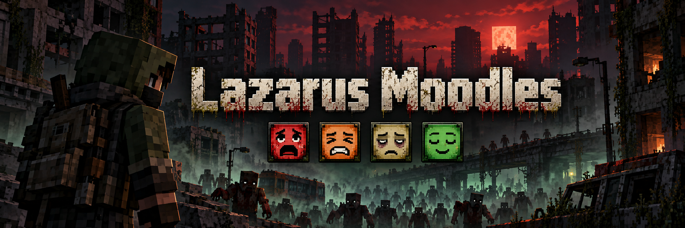

<p align="center">
  
</p>

<p align="center">
  
  
  
  
</p>

# Lazarus Moodles

**Lazarus Moodles** é um mod para Minecraft Forge 1.20.1 feito para o modpack **Project Lazarus**, um survival horror num apocalipse zumbi. Ele dá ao personagem um estado físico e emocional: medo, dor, exaustão e alívio. Inspirado nos *moodles* de Project Zomboid, cada estado aparece como um pequeno ícone no HUD e muda de verdade a forma como você joga, vê e ouve o mundo.

Não são só números numa barra. Quando o personagem entra em pânico, você ouve o coração disparar e a respiração ofegante, a borda da tela fica vermelha e a mira treme. Quando está exausto, as pálpebras pesam e ele boceja. Quando escapa de uma horda, solta um suspiro de alívio e o coração desacelera aos poucos.

> Os textos dentro do jogo (nomes dos moodles e atributos) são em inglês. As habilidades da árvore Coragem seguem o idioma das outras árvores do modpack.

---

## Sumário

- [Moodles](#moodles)
  - [Medo: Tense, Fearful, Panicked](#medo-tense--fearful--panicked)
  - [Dor: Pain](#dor-pain)
  - [Exaustão: Exhausted](#exaustão-exhausted)
  - [Alívio: Relieved](#alívio-relieved)
- [Árvore de habilidades Coragem](#árvore-de-habilidades-coragem)
- [HUD](#hud)
- [Integrações opcionais](#integrações-opcionais)
- [Acessibilidade](#acessibilidade)
- [Comandos de teste](#comandos-de-teste)
- [Moodles futuros](#moodles-futuros)
- [Instalação](#instalação)
- [Créditos e licença](#créditos-e-licença)

---

## Moodles

### Medo: Tense → Fearful → Panicked

Um único moodle de medo com três estágios. A cada segundo o servidor avalia monstros num raio de 18 blocos, a luz no seu bloco e a sua vida:

| Situação | Estágio alcançado |
|---|---|
| 1+ monstro por perto, ou escuridão (luz abaixo de 4) | **Tense** |
| 3+ monstros, ou vida abaixo de 45% | **Fearful** |
| 6+ monstros, ou 3+ monstros com vida abaixo de 50% | **Panicked** |

O medo sobe de 8 a 10 pontos por segundo até o estágio da situação e cai 5 por segundo quando a ameaça passa. Tomar dano dá um susto imediato.

**Efeitos de jogo**
- Gasto extra de fome e de sede (sede com Legendary Survival Overhaul) em todos os estágios.
- A mira oscila ao mirar com armas do TaCZ, arcos, bestas e tridentes: cerca de 0,35° / 0,9° / 1,8° por estágio, com tremor nas mãos a partir de Fearful. A oscilação aumenta depois de correr ou tomar dano.
- A recarga das armas do TaCZ fica mais lenta: cerca de 1,10× / 1,25× / 1,45× o tempo normal.

**Imersão**
- Batimento cardíaco a ~86 bpm em Fearful e ~133 bpm em Panicked.
- Respiração ofegante com quatro gravações diferentes, em intervalos, tom e volume aleatórios para não soar repetitiva.
- Borda vermelha na tela, que cresce por estágio e pulsa com o coração.
- Panicked adiciona um flash vermelho a cada batida, um leve efeito de visão de túnel e a câmera tremendo.

### Dor: Pain

A dor depende da vida e dos golpes recentes:

| Nível | Quando |
|---|---|
| 1 | vida em 80% ou menos |
| 2 | vida em 50% ou menos |
| 3 | vida em 25% ou menos |

- **Dor aguda:** cada golpe sobe a dor um nível, até o máximo de 3, por 5 segundos.
- **Analgésicos:** a morfina do Legendary Survival Overhaul (`painkiller`) e o analgésico do Apocalypse Now (`painkillerseffect`) reduzem a dor em 2 níveis enquanto estão ativos.

**Efeitos de jogo:** velocidade de ataque corpo a corpo −4/8/12%, regeneração de stamina −5/10/15% e subida mais lenta em escadas e trepadeiras.

**Imersão:** a cada golpe o personagem geme de dor (quatro gravações), a câmera dá um tranco para longe do golpe e a tela pisca num tom pálido. Em Pain 3, um golpe forte deixa um zumbido no ouvido por alguns segundos. Os analgésicos suprimem todos esses efeitos.

### Exaustão: Exhausted

Sobe um nível a cada **1.000 blocos percorridos a pé**, até o nível 5. Veículos, nado e teletransportes não contam.

**Como recuperar**
- Dormir a noite inteira, ou ficar **2 minutos deitado na cama**, zera a exaustão. A regra dos 2 minutos existe porque em servidores raramente dá para pular a noite.
- Ficar **agachado, parado e sem medo** reduz um nível por minuto, até o nível 2.

**Efeitos de jogo**

| Nível | 1 | 2 | 3 | 4 | 5 |
|---|---|---|---|---|---|
| Regeneração de stamina | −5% | −10% | −15% | −20% | −25% |
| Custo do sprint | +6% | +12% | +18% | +24% | +30% |
| Custo do pulo e do ataque | | | +10% | +20% | +30% |
| Stamina máxima | | | | −10% | −20% |
| Velocidade | | | | −3% | −6% |
| Oscilação extra da mira | | | | +0,3° | +0,5° |
| Fome e sede extras | | | | sim | sim (dobro) |

**Imersão:** piscadas lentas a partir do nível 3, bocejos, respiração cansada depois de correr (nível 4+) e bordas escuras na tela. No nível 5 acontecem microssonos raros: os olhos fecham por ~1 segundo e a cabeça cai.

### Alívio: Relieved

Aparece quando você **escapa de monstros**, e a força depende do medo que você passou:

| Escapou estando… | Alívio |
|---|---|
| Tense | +20 |
| Fearful | +40 |
| Panicked | +70 |
| Sem medo | nada |

Só conta o medo que realmente subiu durante a ameaça. Um zumbi que entra e sai do raio não gera alívio repetido.

**Bônus por nível (1 a 4):** o medo cai 7/8/9/10 por segundo, em vez de 5. A mira fica 20/30/40/50% mais firme. A regeneração de stamina sobe 5/10/15/20%.

**Imersão:** um suspiro de alívio, uma ou duas respirações calmas, o coração desacelerando aos poucos até silenciar e a visão se abrindo levemente por alguns segundos.

---

## Árvore de habilidades Coragem

Com o **Puffish Skills**, o personagem fica mais corajoso conforme sobrevive. A árvore **Coragem** tem seis habilidades:

```
                [Sangue Frio]
                /           \
     [Nervos de Aço]     [Respiração Controlada]
           |                     |
      [Veterano]            [Mãos Firmes]
                \           /
               [Inabalável]
```

| Habilidade | Efeito |
|---|---|
| **Sangue Frio** | O medo sobe 10% mais devagar |
| **Nervos de Aço** | +10% (20% no total). Dano assusta 25% menos |
| **Veterano** | A escuridão sozinha não causa mais medo |
| **Respiração Controlada** | O medo cai 2 pontos por segundo mais rápido |
| **Mãos Firmes** | A oscilação da mira e a recarga lenta causadas pelo medo ficam 30% mais fracas |
| **Inabalável** | O pânico exige 8 monstros em vez de 6 (4 em vez de 3 com vida baixa) |

**Como ganhar XP de Coragem**

| Ação | XP |
|---|---|
| Escapar estando Fearful | 3 |
| Escapar estando Panicked | 8 |
| Matar um monstro estando Fearful ou Panicked | 1 |
| Cada dia sobrevivido | 3 |

O XP de fuga tem intervalo mínimo de 2 minutos, e fugas em Tense não dão XP, para evitar farm. A redução do medo tem limite de 35%: mesmo com a árvore completa, uma horda ainda pode levar ao pânico.

---

## HUD

Os moodles ativos ficam empilhados no lado direito da tela, como ícones de 20px:

- A **cor do quadrado** mostra a gravidade. Nos moodles ruins ela vai do amarelo ao laranja e ao vermelho; no Relieved, ao verde.
- O **nome** aparece só quando o moodle surge ou muda de nível e some depois de ~3 segundos.
- Ícones estáveis ficam com 65% de opacidade, para não poluir a tela.
- **F1** esconde tudo.

---

## Integrações opcionais

Nenhuma é obrigatória. Cada efeito é ativado só quando o mod correspondente está instalado.

| Mod | O que o Lazarus Moodles usa |
|---|---|
| **TaCZ** | Detecta quando você mira e deixa a recarga mais lenta com medo |
| **PeakStamina** | Regeneração, stamina máxima e custos de sprint, pulo e ataque |
| **Legendary Survival Overhaul** | Sede extra com medo e exaustão; morfina contra a dor |
| **Apocalypse Now** | Analgésico contra a dor |
| **Puffish Skills** | Árvore de habilidades Coragem |

---

## Acessibilidade

- Bordas, flashes, piscadas, tranco e tremor de câmera respeitam o controle **Distortion Effects** do Minecraft (Opções → Acessibilidade).
- O efeito de visão de túnel e a abertura da visão respeitam o controle **FOV Effects**.
- Nenhum efeito dos moodles se aplica em Criativo ou Espectador.

---

## Comandos de teste

Comandos de operador (permissão 2). Os níveis forçados são temporários e não mudam a vida nem a distância percorrida.

| Comando | Função |
|---|---|
| `/lm fear 0..3` | 1 Tense, 2 Fearful, 3 Panicked |
| `/lm pain 0..3` | Força a dor |
| `/lm exhausted 0..5` | Força a exaustão |
| `/lm relieved 0..4` | Força o alívio |
| `/lm status` | Mostra os níveis atuais e quais estão forçados |
| `/lm clear [moodle]` | Remove todos os níveis forçados, ou só o de um moodle |

`/lazarusmoodles` é um alias de `/lm`.

---

## Moodles futuros

Dois moodles estão planejados, aproveitando sistemas que o Project Lazarus já tem:

### 🩸 Bleeding (Sangrando)
Ligado ao sangramento do **Apocalypse Now**. A ideia é tornar a hemorragia assustadora e visível: sangue pulsando no canto da tela, a vista escurecendo aos poucos e o coração acelerado. Isso valoriza bandagens e kits médicos e conversa com o sistema do modpack em que o rastro de sangue atrai zumbis.

### 🦠 Sick / Infected (Infectado)
Ligado aos estágios da infecção do **The Hordes**, a infecção do modpack. Conforme a doença avança: tosse, febre com a visão turva e tremores, náusea e menos stamina. O objetivo é que você *sinta* a infecção e a urgência de encontrar antibióticos, em vez de só acompanhar uma barra.

---

## Instalação

### Requisitos

- **Minecraft 1.20.1**
- **Minecraft Forge 47.x** (desenvolvido com o 47.4.10)
- **Java 17** (incluído no launcher do Minecraft e no CurseForge)

### Jogadores (single player ou cliente)

1. Instale o Forge 1.20.1, pelo [instalador oficial](https://files.minecraftforge.net/net/minecraftforge/forge/index_1.20.1.html) ou criando um perfil Forge no CurseForge.
2. Baixe o JAR mais recente em [`dist/`](dist/), atualmente [`lazarusmoodles-1.11.1.jar`](dist/lazarusmoodles-1.11.1.jar).
3. Coloque o arquivo na pasta `mods` do perfil:
   - **CurseForge:** clique com o botão direito no perfil → *Open Folder* → `mods`
   - **Launcher oficial:** `%appdata%\.minecraft\mods`
4. Se houver uma versão anterior do `lazarusmoodles` na pasta, **remova-a** para não ficar com duas versões.
5. Feche o Minecraft antes de trocar o arquivo e abra o jogo depois.

### Servidor

1. Coloque o mesmo JAR na pasta `mods` do servidor.
2. **Todos os jogadores** precisam da mesma versão do mod. Cliente e servidor com versões diferentes não conseguem se conectar.
3. Os mundos existentes continuam funcionando: os dados novos começam zerados.

### Árvore Coragem (opcional, requer Puffish Skills)

1. Copie a pasta [`extras/puffish_skills/categories/coragem`](extras/puffish_skills/categories/coragem) para `config/puffish_skills/categories/coragem` no perfil e no servidor.
2. Adicione `"coragem"` à lista `categories` em `config/puffish_skills/config.json`.
3. Para o XP por dia sobrevivido, chame `puffish_skills experience add <jogador> puffish_skills:coragem 3` uma vez por dia de jogo. No Project Lazarus isso é feito pelo script KubeJS `lazarus_skills_xp.js`. O XP de fugas e abates vem do próprio mod.

### Compilar a partir do código

Com o JDK 17 instalado:

```bash
gradlew build
```

O JAR é gerado em `build/libs/`.

---

## Créditos e licença

- Desenvolvido por **Kaique Melo** para o modpack **Project Lazarus**.
- Ícones dos moodles: pixel art original.
- Sons de respiração, batimento, gemidos, bocejos e suspiros: gerados com ElevenLabs. O zumbido no ouvido é sintetizado.
- Banner: gerado com IA.
- Inspirado nos moodles de *Project Zomboid*. Não é afiliado à The Indie Stone, à Mojang ou à Microsoft.

**Licença:** All Rights Reserved.
